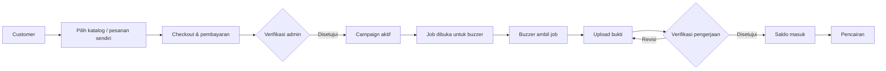

<div align="center">

# BuzzHub

**Platform jasa buzzer & viral marketing untuk brand, UMKM, dan kreator.**

Menghubungkan customer dengan buzzer terverifikasi untuk campaign Instagram, TikTok, X/Twitter, Facebook, YouTube, dan Telegram — lengkap dengan pembayaran, verifikasi pengerjaan, payout, dan laporan.

[](https://react.dev)
[](https://tanstack.com/start)
[](https://www.typescriptlang.org)
[](https://tailwindcss.com)
[](https://supabase.com)
[](https://vite.dev)

[](#)
[](https://lovable.dev/projects/754972da-b5d7-4e2a-ae1b-8bf0fff12827)

[Ringkasan](#ringkasan) · [Fitur](#fitur) · [Tech Stack](#tech-stack) · [Mulai Cepat](#mulai-cepat) · [Supabase](#supabase) · [Akun Demo](#akun-demo) · [Model Harga](#model-harga) · [Troubleshooting](#troubleshooting)


</div>

---

## Ringkasan

BuzzHub adalah aplikasi web untuk mengelola ekosistem jasa buzzer dalam satu tempat:

- **Customer** memesan campaign dari katalog atau membuat pesanan sendiri, lalu memantau pembayaran dan hasilnya.
- **Buzzer** mengambil job, mengirim bukti pengerjaan, memantau penghasilan, dan mengajukan pencairan.
- **Admin** memverifikasi buzzer, pembayaran, bukti pengerjaan, dan payout, serta mengelola katalog, harga, user, dan aktivitas.

Aplikasi memiliki tiga dashboard terpisah dengan role-based access, data realtime dari Supabase, penyimpanan bukti di Supabase Storage, dan fallback data demo agar tampilan langsung terisi saat pertama kali dijalankan.

### Highlight

- **Tiga dashboard** — admin, customer, dan buzzer dengan navigasi masing-masing.
- **Alur end-to-end** — pesan → bayar → verifikasi → job → bukti → payout.
- **Dua model harga** — katalog paket fixed-price dan pesanan sendiri per buzzer.
- **Realtime** — campaign, job, pembayaran, dan status verifikasi diperbarui lewat Supabase Realtime.
- **Bukti pengerjaan** — upload screenshot/PDF, riwayat revisi, dan verifikasi admin.
- **Support in-app** — customer/buzzer mengirim pesan dari menu Bantuan, admin membalas dari inbox Pesan, dan balasan masuk ke lonceng notifikasi pengguna.
- **Demo-ready** — akun demo, katalog contoh, dan data dashboard deterministik.

> [!NOTE]
> Repo ini terhubung ke [Lovable](https://lovable.dev/projects/754972da-b5d7-4e2a-ae1b-8bf0fff12827). Push ke branch yang terhubung akan disinkronkan kembali ke editor Lovable. Hindari force push atau menulis ulang history yang sudah dipublikasikan.

---

## Fitur

### Landing Page

- Hero dengan value proposition, statistik platform, dan CTA.
- Section layanan, alur proses, testimoni, dan CTA penutup.
- Halaman login, register customer, register buzzer, dan profil publik buzzer.
- Tema terang/gelap dan favicon BuzzHub.

### Customer — `/customer`

- **Homepage** — ringkasan campaign, statistik, rekomendasi layanan, dan aktivitas terbaru.
- **Pesanan** — buat pesanan baru (custom), lihat detail campaign, progres, dan riwayat.
- **Katalog** — paket layanan siap beli dengan harga dan jumlah buzzer tetap.
- **Pembayaran** — invoice, status pembayaran, dan riwayat transaksi.
- **Ulasan** — beri rating dan komentar untuk buzzer setelah campaign selesai.
- **Bantuan** — FAQ yang bisa dicari, panduan cepat, tombol kirim pesan ke admin, dan channel support alternatif.
- **Notifikasi** — balasan admin atas pesan Bantuan muncul di lonceng notifikasi; klik untuk membaca pertanyaan asal + balasan lengkap, lalu buka halaman Bantuan bila perlu.
- **Pengaturan** — preferensi notifikasi dan pengaturan akun.

### Buzzer — `/buzzer`

- **Job Tersedia** — cari dan ambil job sesuai platform dan level akun.
- **Job Saya** — pantau job yang sedang dikerjakan, upload bukti, dan perbaiki jika diminta revisi.
- **Akun Sosial Media** — hubungkan dan verifikasi akun sosial untuk tiap platform.
- **Penghasilan** — saldo, status payout, riwayat penghasilan, dan pengajuan pencairan.
- **Rating & Ulasan** — lihat rating dan feedback dari customer.
- **Profil** — kelola data diri, avatar, dan informasi publik.
- **Bantuan** — FAQ seputar job, bukti, dan pencairan, plus tombol kirim pesan ke admin.
- **Notifikasi** — balasan admin atas pesan Bantuan masuk ke lonceng notifikasi; klik untuk membaca pertanyaan asal + balasan lengkap, lalu buka halaman Bantuan bila perlu.
- **Pengaturan** — preferensi notifikasi dan akun.

### Admin — `/admin`

- **Dashboard** — ringkasan kampanye, buzzer aktif, customer, pembayaran, dan grafik aktivitas.
- **Kampanye** — kelola pesanan, katalog layanan, dan harga pesanan sendiri.
- **Manajemen User** — kelola akun customer dan buzzer.
- **Pesan** — inbox pesan Bantuan dari customer & buzzer; balas langsung dari dashboard, badge menandai pesan masuk yang belum dibaca, dan balasan otomatis dikirim ke notifikasi pengguna.
- **Verifikasi Buzzer** — setujui atau tolak pendaftaran buzzer.
- **Verifikasi Pengerjaan** — periksa bukti job, setujui, atau minta revisi.
- **Verifikasi Pembayaran** — konfirmasi pembayaran customer dan buka campaign.
- **Verifikasi Pencairan** — proses pengajuan payout buzzer.
- **Metode Pembayaran** — kelola rekening dan channel pembayaran.
- **Aktivitas** — grafik dan riwayat aktivitas platform.
- **Akun Sosial Media** — verifikasi akun sosial milik buzzer.
- **Ulasan & Rating** — moderasi ulasan customer.
- **Pengaturan** — pengaturan platform dan akun admin.

---

## Alur Singkat



---

## Tech Stack

| Layer           | Teknologi                                                     |
| --------------- | ------------------------------------------------------------- |
| Frontend        | React 19, TanStack Start, TanStack Router, TypeScript         |
| Build           | Vite 8, Nitro                                                 |
| UI              | Tailwind CSS 4, Radix UI, komponen shadcn-style, Lucide Icons |
| Data & backend  | Supabase Postgres, Realtime, Storage, Row Level Security      |
| Chart           | Recharts                                                      |
| Form & validasi | React Hook Form, Zod                                          |
| Export          | jsPDF, XLSX                                                   |
| Notifikasi      | Sonner                                                        |
| Tooling         | ESLint, Prettier, npm                                         |

---

## Struktur Proyek

```text
.
├─ src/
│  ├─ routes/                 # route file-based: landing, login, dashboard
│  ├─ components/             # UI reusable: sidebar, help, chart, settings
│  │  └─ ui/                  # primitive shadcn/Radix
│  ├─ lib/                    # domain logic, store, auth, query Supabase
│  ├─ integrations/supabase/  # Supabase client & generated types
│  ├─ hooks/
│  ├─ assets/
│  ├─ styles.css              # Tailwind theme & design token
│  ├─ router.tsx
│  └─ routeTree.gen.ts        # auto-generated, jangan diedit manual
├─ supabase/
│  ├─ migrations/             # schema, RLS, storage, seed demo
│  └─ config.toml
├─ public/                    # favicon & aset statis
├─ scratch/                   # script verifikasi lokal (gitignored)
├─ .env.example
└─ package.json
```

> [!TIP]
> Konvensi routing ada di [`src/routes/README.md`](src/routes/README.md). Jangan membuat `src/pages/` atau layout ala Next.js/Remix — root layout ada di `src/routes/__root.tsx`.

---

## Mulai Cepat

### Prasyarat

- **Node.js 22.12+** — dibutuhkan oleh TanStack Start.
- **npm 10+** — atau `bun` jika lebih nyaman.
- **Project Supabase** — cloud atau lokal.
- **Git**.

### 1. Clone & install

```bash
git clone <repository-url>
cd "Jasa Buzzer"
npm install
```

Menggunakan Bun:

```bash
bun install
```

### 2. Siapkan environment

```bash
cp .env.example .env
```

Windows PowerShell:

```powershell
Copy-Item .env.example .env
```

Isi `.env` dengan kredensial Supabase:

```env
VITE_SUPABASE_URL="https://your-project.supabase.co"
VITE_SUPABASE_PUBLISHABLE_KEY="sb_publishable_..."
```

> [!WARNING]
> Jangan commit `.env`. Jangan pernah menaruh `SUPABASE_SERVICE_ROLE_KEY` di variabel `VITE_*` karena nilainya akan ikut terkirim ke browser.

### 3. Jalankan development server

```bash
npm run dev
```

Buka **http://localhost:8080** (port mengikuti konfigurasi Vite/Lovable).

### 4. Build production

```bash
npm run build
npm run preview
```

Hasil build berada di `.output/`.

---

## Environment Variables

| Variable                        | Dibaca oleh  | Wajib | Keterangan                                         |
| ------------------------------- | ------------ | ----- | -------------------------------------------------- |
| `VITE_SUPABASE_URL`             | Client + SSR | Ya    | URL project Supabase.                              |
| `VITE_SUPABASE_PUBLISHABLE_KEY` | Client + SSR | Ya    | Publishable/anon key. Aman dipakai di client.      |
| `SUPABASE_URL`                  | SSR/server   | Tidak | Fallback server-side jika `VITE_*` tidak tersedia. |
| `SUPABASE_PUBLISHABLE_KEY`      | SSR/server   | Tidak | Fallback server-side untuk publishable key.        |
| `SUPABASE_SERVICE_ROLE_KEY`     | Server-only  | Tidak | Untuk script/admin. **Jangan expose ke client.**   |

Client Supabase juga mendukung format key baru `sb_publishable_...`. Jika key tidak ada, aplikasi akan menampilkan warning dan fitur database tidak berjalan.

---

## Supabase

### Migrations

Semua schema, RLS, storage bucket, function, trigger, dan seed demo ada di `supabase/migrations/`.

Dengan Supabase CLI:

```bash
supabase link --project-ref <project-ref>
supabase db push
```

Atau lewat **Supabase Dashboard → SQL Editor**:

1. Jalankan file migration sesuai urutan nama file.
2. Pastikan migration terbaru `20261027000000_connect_demo_buzzer_data.sql` dijalankan untuk seed demo.
3. Jika schema baru belum terbaca, jalankan:

```sql
NOTIFY pgrst, 'reload schema';
```

> [!IMPORTANT]
> Untuk production, jalankan bagian schema dari migration, tetapi jangan memuat data demo. Lewati atau hapus blok seed demo di `20261027000000_connect_demo_buzzer_data.sql`, lalu buat akun admin secara manual.

### Storage

| Bucket                | Public | Digunakan untuk              | Format                           |
| --------------------- | ------ | ---------------------------- | -------------------------------- |
| `bukti-pengerjaan`    | Tidak  | Bukti pengerjaan buzzer      | JPG, PNG, WEBP, PDF              |
| `campaign-thumbnails` | Ya     | Thumbnail katalog & campaign | JPG, PNG, WEBP, GIF (maks. 5 MB) |

Bukti pengerjaan diakses lewat **signed URL**. Jangan mengubah bucket `bukti-pengerjaan` menjadi public.

### Realtime & RLS

- Tabel utama sudah ditambahkan ke publication `supabase_realtime` oleh migration.
- RLS aktif di tabel-tabel utama; client memakai publishable/anon key.
- Pesan support memakai `campaign_messages` dengan `campaign_id = null`; balasan admin juga membuat baris `notifications` agar muncul di lonceng customer/buzzer. Di production, batasi SELECT/INSERT/UPDATE per user dan jangan memakai policy `demo_all`.
- Beberapa policy dibuat permisif untuk kebutuhan demo. **Review ulang policy sebelum production.**

### Autentikasi

Login dan register ditangani oleh server function di `src/lib/accounts.functions.ts` dan tabel `app_accounts`. Session disimpan di `localStorage` dengan key `buzzhub.session`. Ini **bukan** Supabase Auth.

### Seed Demo

Migration `20261027000000_connect_demo_buzzer_data.sql` menyiapkan:

- akun demo, application, wallet, dan 5 akun sosial;
- 8 campaign/job demo;
- riwayat submission dan normalisasi kolom bukti;
- 6 katalog layanan aktif;
- RLS dan storage policy untuk bukti pengerjaan.

Dashboard juga memiliki fallback data demo deterministik di `src/lib/demo-data.ts`. Data asli dari Supabase akan dipakai ketika jumlah baris sudah mencukupi (umumnya ≥ 10 baris). Landing page memakai data ringan dari `src/lib/mock-data.ts`.

---

## Akun Demo

| Role     | Email                 | Password       | Dashboard   |
| -------- | --------------------- | -------------- | ----------- |
| Admin    | `admin@buzzhub.id`    | `Admin123!`    | `/admin`    |
| Customer | `customer@buzzhub.id` | `Customer123!` | `/customer` |
| Buzzer   | `buzzer@buzzhub.id`   | `Buzzer123!`   | `/buzzer`   |

Akun demo juga tercantum di halaman login.

> [!IMPORTANT]
> Ganti password demo dan hapus akun demo sebelum production. Akun yang terdaftar di database disimpan di tabel `app_accounts`.

---

## Model Harga

Ada dua model harga yang **terpisah** dan dikelola admin:

| Aspek         | Katalog                      | Pesanan Sendiri                 |
| ------------- | ---------------------------- | ------------------------------- |
| Sumber data   | `service_catalogs`           | `service_pricing`               |
| Harga         | Total paket (`price`)        | Per buzzer (`price_per_buzzer`) |
| Jumlah buzzer | Tetap (`slots`)              | Dipilih customer                |
| Total bayar   | `price`                      | `price_per_buzzer × slots`      |
| Cocok untuk   | Paket siap beli, scope jelas | Kebutuhan fleksibel             |
| Contoh        | Rp1.500.000 untuk 50 buzzer  | Rp8.000 × 10 = Rp80.000         |

- **Katalog** dikelola di **Admin → Kampanye → Katalog Layanan**.
- **Pesanan sendiri** dikelola di **Admin → Kampanye → Harga Pesanan Sendiri**.
- Harga katalog adalah **harga total paket**, bukan harga per buzzer. Harga efektif per buzzer = `price / slots`.
- Pembagian payout mengikuti aturan platform (60/40) dan level buzzer. Lihat migration terkait untuk detail trigger/function.

> [!TIP]
> Jika ingin harga katalog mengikuti rate card, isi `Harga Pesanan` = `price_per_buzzer × slots` (ditambah margin jika perlu). Jangan memasukkan harga per buzzer ke kolom harga katalog.

---

## Scripts

| Command             | Fungsi                               |
| ------------------- | ------------------------------------ |
| `npm run dev`       | Jalankan development server.         |
| `npm run build`     | Build production.                    |
| `npm run build:dev` | Build dengan mode development.       |
| `npm run preview`   | Preview hasil build.                 |
| `npm run lint`      | Jalankan ESLint.                     |
| `npm run format`    | Format seluruh file dengan Prettier. |

---

## Database Ringkas

| Tabel                      | Fungsi                                                           |
| -------------------------- | ---------------------------------------------------------------- |
| `app_accounts`             | Akun admin, customer, buzzer, role, password hash, profil.       |
| `campaigns`                | Campaign yang dipesan customer: budget, slot, jadwal, status.    |
| `campaign_jobs`            | Job per buzzer: payout snapshot, status, link bukti.             |
| `campaign_messages`        | Percakapan campaign & pesan support in-app (`campaign_id` null). |
| `notifications`            | Notifikasi in-app, termasuk balasan admin atas pesan Bantuan.     |
| `campaign_job_submissions` | Riwayat upload dan revisi bukti pengerjaan.                      |
| `service_catalogs`         | Paket katalog fixed-price.                                       |
| `catalog_packages`         | Paket tambahan per katalog (opsional).                           |
| `service_pricing`          | Rate card per buzzer untuk pesanan sendiri.                      |
| `payments`                 | Invoice, nominal, dan status pembayaran.                         |
| `withdrawals`              | Pengajuan pencairan saldo buzzer.                                |
| `buzzer_wallets`           | Saldo dan mutasi penghasilan buzzer.                             |
| `buzzer_ratings`           | Rating dan ulasan customer untuk buzzer.                         |
| `social_accounts`          | Akun sosial buzzer dan status verifikasinya.                     |

Skema lengkap, function, trigger, dan policy ada di `supabase/migrations/`.

---

## Deployment dan Lovable

- Editor Lovable: [lovable.dev/projects/754972da-b5d7-4e2a-ae1b-8bf0fff12827](https://lovable.dev/projects/754972da-b5d7-4e2a-ae1b-8bf0fff12827)
- Push ke branch yang terhubung akan disinkronkan ke Lovable.
- Perubahan lokal yang belum di-commit **tidak** muncul di preview Lovable.
- Build production menghasilkan output di `.output/` dan dapat di-deploy ke platform yang mendukung Nitro/Node/Cloudflare.

> [!IMPORTANT]
> Jangan force push, rebase, amend, atau squash commit yang sudah dipublikasikan. Itu dapat menulis ulang history di sisi Lovable.

---

## Troubleshooting

| Gejala                            | Kemungkinan penyebab                                       | Solusi                                                               |
| --------------------------------- | ---------------------------------------------------------- | -------------------------------------------------------------------- |
| Dashboard menampilkan data demo   | Tabel Supabase masih kosong atau kurang dari 10 baris      | Isi data atau jalankan seed demo.                                    |
| Katalog customer kosong           | `service_catalogs` kosong atau tidak ada yang `Aktif`      | Tambah katalog di Admin → Kampanye → Katalog Layanan.                |
| Pesanan sendiri tidak bisa lanjut | `service_pricing` untuk platform + jenis layanan belum ada | Tambah di Admin → Harga Pesanan Sendiri.                             |
| Upload bukti gagal                | Bucket/policy/format tidak sesuai                          | Cek bucket `bukti-pengerjaan`, policy, dan format JPG/PNG/WEBP/PDF.  |
| Upload thumbnail gagal            | Bucket `campaign-thumbnails` belum ada                     | Jalankan migration storage atau buat bucket public.                  |
| Realtime tidak update             | Tabel belum masuk publication atau RLS menolak SELECT      | Cek publication `supabase_realtime`, policy, lalu reload schema.     |
| Login gagal                       | Akun tidak ada di `app_accounts`                           | Gunakan akun demo atau daftar akun baru.                             |
| `prettier/prettier Delete ␍`      | Line ending CRLF di Windows                                | Jalankan `npm run format`; set `git config core.autocrlf input`.     |
| Port 8080 sudah dipakai           | Proses lain berjalan                                       | Hentikan proses tersebut atau jalankan `npm run dev -- --port 8081`. |
| Build gagal karena Node           | Versi Node terlalu lama                                    | Gunakan Node.js 22.12+.                                              |

---

## Keamanan

- Jangan commit `.env` atau service role key.
- Gunakan publishable/anon key hanya untuk client.
- Auth saat ini adalah auth aplikasi demo (`app_accounts` + SHA-256 salt statis). Untuk production, pertimbangkan Supabase Auth atau hashing Argon2/bcrypt, rate limiting, dan verifikasi email.
- Review RLS dan storage policy sebelum production; beberapa policy dibuat permisif untuk kebutuhan demo.
- Hapus akun dan data demo sebelum go-live.
- Batasi akses dashboard admin dan audit perubahan data sensitif.

---

## Kontribusi

1. Buat branch dari `main`.
2. Jalankan `npm run lint` dan `npm run build` sebelum membuat PR.
3. Tambahkan migration baru untuk perubahan schema — jangan mengedit migration yang sudah dijalankan di production.
4. Jangan force push ke branch yang terhubung ke Lovable.
5. Simpan script eksperimen lokal di `scratch/` (sudah gitignored).

---

<div align="center">

**BuzzHub** — dibuat untuk ekosistem buzzer Indonesia.

<sub>© 2026 BuzzHub. Proyek privat. Semua hak dilindungi.</sub>

</div>
